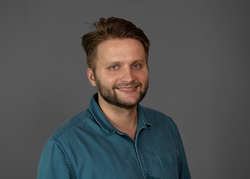

  

    

      
PhD student in Economics · Uppsala University

      <h1>Wojciech Szymczak</h1>
      
I study education, labour markets, and applied econometrics, with particular interest in the transition from education to the labour market.

      

        <a href="/files/CV_Szymczak.pdf">Download CV</a>
        <a href="mailto:wojciech.szymczak@nek.uu.se">Email</a>
        <a href="https://scholar.google.com/citations?user=w1tir28AAAAJ&hl=pl">Google Scholar</a>
        <a href="https://github.com/szymczakwojciech">GitHub</a>
        <a href="https://bsky.app/profile/wojszymcz.bsky.social">Bluesky</a>
      

    

    
  

  <section>
    <h2>About</h2>
    
I am a PhD student in Economics at Uppsala University. I hold a degree in Econometrics from the University of Warsaw. My research lies at the intersection of education, labour economics, and applied econometrics.

  </section>

  <section>
    <h2>Research</h2>
    <h3>Working paper</h3>
    
<strong>Automation, Trade Unions and Atypical Employment</strong> with Piotr Lewandowski (IBS, IZA, RWI). Revise and resubmit at <em>Industrial Relations</em>.

    <h3>Work in progress</h3>
    <ul>
      <li><strong>Bread &amp; Salt?</strong> Evidence on the impact of Ukrainian refugees in the Polish education system.</li>
      <li><strong>New forms of work and workers’ demand for security and stability</strong>, with Zuzanna Kowalik (IBS, University of Warsaw) and Piotr Lewandowski (IBS, IZA, RWI).</li>
      <li><strong>Learning Method Effectiveness and Subjective Expectations Regarding Individual Labour Market Entry.</strong></li>
    </ul>

    <h3>Publication</h3>
    
Szymczak, Wojciech and Tomasz Gajderowicz. “Distance Does Matter, but Time is Critical: The Role of Spatial and Institutional Features in Choosing HEI.” <em>Journal of School Choice</em>, 17(2), 2023.

  </section>

  <section>
    <h2>Contact</h2>
    
<a href="mailto:wojciech.szymczak@nek.uu.se">wojciech.szymczak@nek.uu.se</a> Uppsala University, Uppsala, Sweden

  </section>

